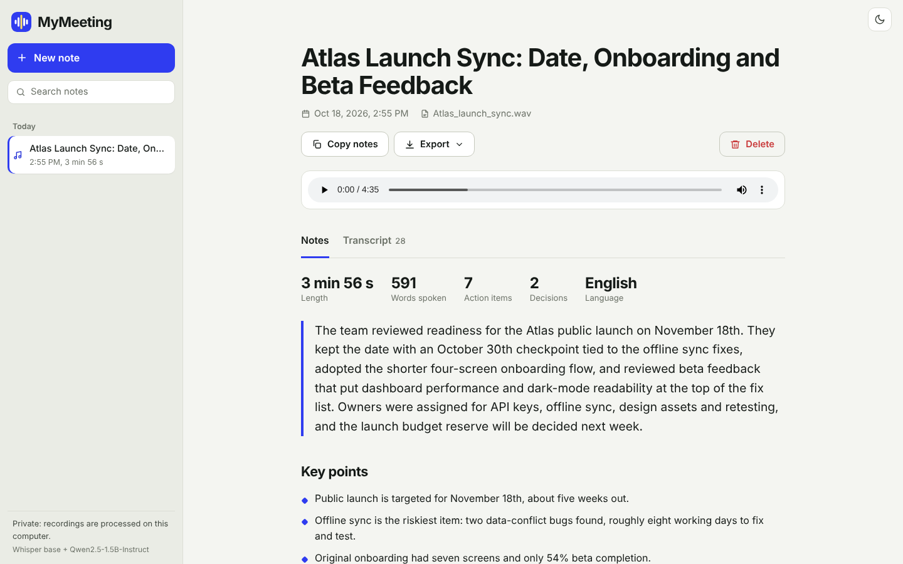
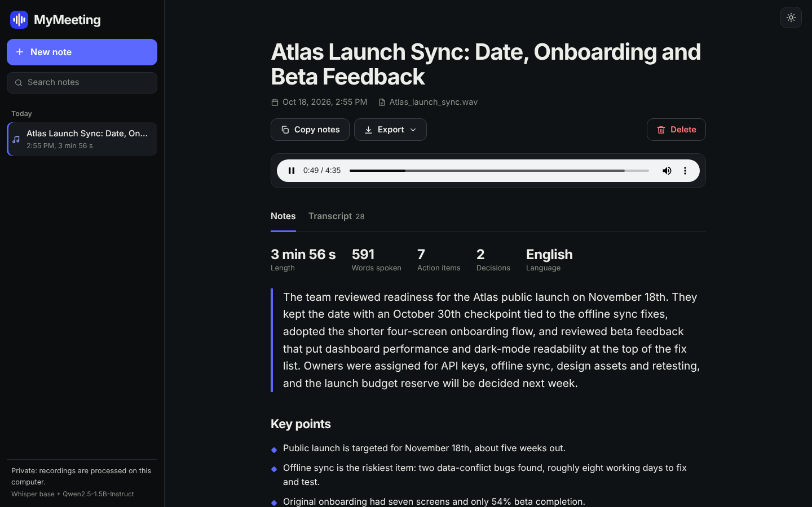
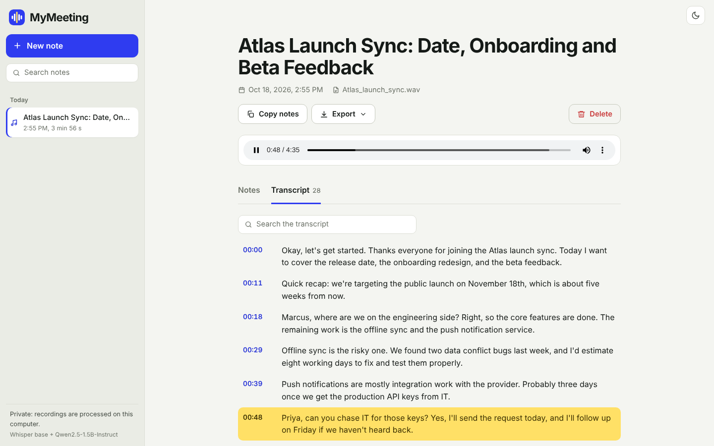
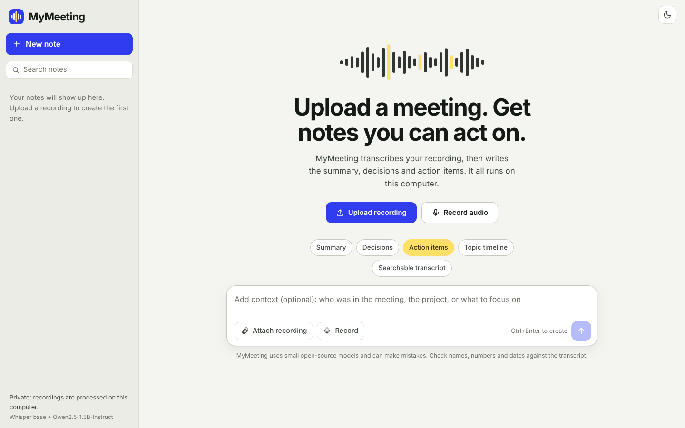
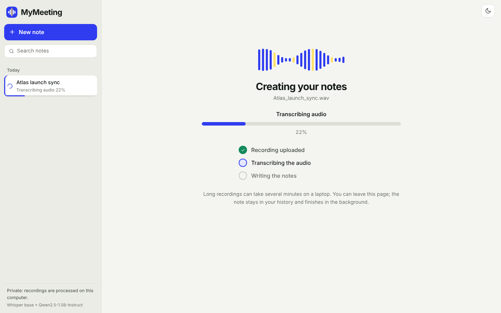

# MyMeeting

Upload a meeting recording and get organized notes: an overview, key points, decisions, action items with owners and due dates, a timeline of topics, and a searchable transcript. Everything runs on your own computer. Audio is transcribed with Whisper and the notes are written by an open-source language model, so nothing is sent to a third-party service.



<table>
  <tr>
    <td></td>
    <td></td>
  </tr>
  <tr>
    <td></td>
    <td></td>
  </tr>
</table>

_Screenshots use a scripted demo transcript (see [Demo mode](#demo-mode))._

## Features

- **Detailed notes**: overview, key points, decisions, action items (with owner and due date when mentioned), a topic timeline, and open questions.
- **Chatbot-style layout**: history on the left, **New note** button, search across all past notes, rename and delete.
- **Timestamped transcript**: click any time to play the recording from that point; the current line highlights as the audio plays. Search inside the transcript.
- **Record or upload**: drag in a file (MP3, WAV, M4A, MP4, WebM, OGG, FLAC and more) or record from the microphone.
- **Context box**: tell the model who was there or what to focus on, and it uses that to interpret names and jargon.
- **Export**: copy the notes, or download Markdown, a plain transcript, or JSON.
- **Light and dark themes**, responsive down to phone width.
- **Private and local**: models run on your machine; notes and recordings live in the `data/` folder.

## How it works

```
recording --> Whisper (faster-whisper) --> timestamped transcript
                                              |
                                  split into chunks of about 3,000 characters
                                              |
                     LLM writes notes per chunk (topic, summary, points,
                     decisions, action items, questions)
                                              |
                     LLM writes the title and overview from the chunk notes
                                              |
                     merge + de-duplicate --> structured notes (SQLite)
```

Chunking means long meetings work with small models: each model call sees only a few minutes of conversation. Recordings are processed one at a time in a background worker, and the page shows live progress.

## Quick start

Requires Python 3.10 to 3.12.

```bash
python -m venv venv
source venv/bin/activate            # Windows PowerShell: .\venv\Scripts\Activate.ps1
pip install -r requirements.txt
python app.py
```

Open http://localhost:5000. The first recording downloads the models (about 150 MB for Whisper `base` and about 3 GB for the notes model), so it takes a few minutes once. Later runs start immediately.

**Memory and speed.** The default notes model, `Qwen/Qwen2.5-1.5B-Instruct`, needs roughly 7 GB of free RAM on a CPU. On a smaller machine use the 0.5B model (about 2 GB, lower quality):

```bash
NOTES_MODEL=Qwen/Qwen2.5-0.5B-Instruct python app.py          # macOS / Linux
$env:NOTES_MODEL="Qwen/Qwen2.5-0.5B-Instruct"; python app.py   # Windows PowerShell
```

Transcription is usually faster than real time on a recent laptop CPU; writing the notes is the slow step and takes a few minutes for a typical meeting. A GPU speeds both up automatically.

## Configuration

Set these as environment variables.

| Variable | Default | What it does |
| --- | --- | --- |
| `WHISPER_MODEL` | `base` | Speech model: `tiny`, `base`, `small`, `medium`, `large-v3`. Bigger is more accurate and slower. |
| `WHISPER_LANGUAGE` | auto-detect | Force a language code such as `en` or `es`. |
| `WHISPER_DEVICE` | `auto` | `auto`, `cpu` or `cuda`. |
| `NOTES_MODEL` | `Qwen/Qwen2.5-1.5B-Instruct` | Any chat/instruct model on Hugging Face, for example `Qwen/Qwen2.5-3B-Instruct` for better notes. |
| `CHUNK_CHARS` | `3200` | Transcript characters per model call. |
| `CPU_THREADS` | library default | CPU threads for Whisper. |
| `MAX_UPLOAD_MB` | `300` | Largest accepted upload. |
| `HOST` / `PORT` | `127.0.0.1` / `5000` | Use `HOST=0.0.0.0` in a cloud IDE or lab environment. |
| `DATA_DIR` | `./data` | Where the database and recordings are stored. |

## Project structure

```
MyMeetingAI/
├── app.py                 # Flask app, REST API, background job
├── engine.py              # Whisper transcription + LLM note pipeline
├── storage.py             # SQLite data layer
├── exporter.py            # Markdown / text export, timestamps
├── templates/index.html
├── static/
│   ├── css/style.css
│   ├── js/script.js
│   └── img/               # logo, favicon
├── tests/                 # pytest suite (models are stubbed)
├── devtools/              # demo server, stand-in models, sample audio script
├── Dockerfile, docker-compose.yml
├── requirements.txt, requirements-dev.txt
└── .github/workflows/tests.yml
```

## API

| Method and path | Purpose |
| --- | --- |
| `GET /api/notes?q=` | List notes, newest first. `q` searches titles, notes and transcripts. |
| `POST /api/notes` | Upload (`multipart/form-data`: `audio`, optional `context`). Returns `202` and starts processing. |
| `GET /api/notes/<id>` | One note with notes, transcript and progress. |
| `PATCH /api/notes/<id>` | Rename (`{"title": "..."}`). |
| `DELETE /api/notes/<id>` | Delete the note and its recording. |
| `POST /api/notes/<id>/retry` | Process a failed note again. |
| `GET /api/notes/<id>/audio` | The recording (supports range requests). |
| `GET /api/notes/<id>/export?format=md\|txt\|json` | Export. Add `&download=1` for a file download. |
| `GET /health` | Status and model names. |

## Tests

```bash
pip install -r requirements-dev.txt
pytest
```

The tests exercise the real transcription loop, chunking, parsing, merging, database and API. Only the two functions that touch a model are replaced by stand-ins, so the suite runs in seconds with no downloads. GitHub Actions runs it on every push.

## Demo mode

To try or edit the interface without downloading any model:

```bash
python devtools/make_sample_audio.py sample.wav 270
python devtools/demo_server.py          # http://localhost:5055
```

Upload `sample.wav`. You get a scripted product-planning meeting. The progress screen, notes, transcript and exports all work as they do with the real models.

## Docker

```bash
docker compose up --build
```

Open http://localhost:5000. Notes and recordings persist in `./data`, and downloaded models are cached in a volume.

## Publish to GitHub

```bash
git init
git add .
git commit -m "Initial commit: MyMeeting"
git branch -M main
git remote add origin https://github.com/YOUR-USERNAME/YOUR-REPO.git
git push -u origin main
```

## Limitations

- Whisper does not identify who is speaking, so the transcript has timestamps but no speaker names. Names in the notes come from what people say aloud.
- Small open-source models can misread names, numbers and dates. Check important details against the transcript.
- Notes are written in the language of the transcript, but quality is best in English.
- The app has no login. It binds to `127.0.0.1` by default; do not expose it to an untrusted network.

## License

MIT
